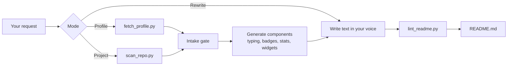

<div align="center">


<br />

<a href="https://github.com/SameerAlSahab/GRE-GitHub-Readme-Enhanced/actions"></a>
<a href="https://github.com/SameerAlSahab/GRE-GitHub-Readme-Enhanced/blob/main/LICENSE"></a>
<a href="https://github.com/SameerAlSahab/GRE-GitHub-Readme-Enhanced/commits/main"></a>


<br />

<a href="#install">Install</a> ·
<a href="#usage">Usage</a> ·
<a href="#layouts">Layouts</a> ·
<a href="#components">Components</a> ·
<a href="#faq">FAQ</a> ·
<a href="https://github.com/SameerAlSahab/GRE-GitHub-Readme-Enhanced/issues/new?labels=bug">Report a bug</a> ·
<a href="https://github.com/SameerAlSahab/GRE-GitHub-Readme-Enhanced/issues/new?labels=enhancement">Request a feature</a>

<br /><br />

<a href="https://github.com/SameerAlSahab/GRE-GitHub-Readme-Enhanced"></a>

</div>

## About

Most GitHub READMEs are either empty or a pile of badges pasted from ten different places, with text that reads like a template. GRE fixes that in three steps:

1. **It looks at real data.** For a profile it reads your repos, languages and bio. For a project it clones the repo and scans it statically, without running anything.
2. **It generates every URL with a script.** Emoji encoding, shields escaping and widget parameters are where hand-built READMEs break, so no URL is typed by hand.
3. **It lints the result.** The linter catches what GitHub's sanitizer strips and the phrases that make text sound machine-written.

You get a README with one accent color, 6 to 9 components instead of 20, and prose that sounds like you.

## Why not just copy a template

| | copy-pasted template | GRE |
|---|---|---|
| Content | placeholder text you forget to replace | built from your GitHub data or your repo's files |
| Badge and widget URLs | typed by hand, silent failures | generated by script, parameters validated |
| Install and usage sections | guessed | taken from manifests and entry points |
| Leaked secrets, license conflicts | not checked | flagged before you publish, secrets masked |
| Writing | stock phrases, em dashes, emoji bullet walls | specific, linted for AI tells |
| Render problems | found after pushing | `style=`, `<script>`, unbalanced tags caught locally |

## Usage

```text
Make my GitHub profile README. Username is octocat-dev, accent hot pink.
```
```text
Write a README for https://github.com/octocat/Hello-World with build status and a star-history chart.
```
```text
Scan my repo for leaked keys and license problems, then write the README.
```
```text
This README sounds like ChatGPT. Rewrite it.
```
```text
Add a snake animation and my latest blog posts to my profile.
```
```text
Draft a copyright and DMCA section for my repo. It bundles some third-party fonts.
```

If GRE doesn't know enough about you, it asks one grouped set of questions first (specialties, links, achievements, a song, tone). Say **skip** and it builds from GitHub data with visible `TODO` markers.

## How it works



## Layouts

Each template ships with a finished sample that passes the linter.

| layout | best for | template | sample |
|---|---|---|---|
| **Showcase** | the full handmade look: typing line, badges, dividers, stats, Now Playing | `showcase.md` | `showcase-example.md` |
| **Bento** | dense card grid: stats and languages side by side, activity graph, blog list | `bento.md` | `bento-example.md` |
| **Terminal** | hacker style: neofetch card and snake | `terminal.md` | `terminal-example.md` |
| **Minimal** | quiet: short bio, icon strip, one card | `minimal.md` | `minimal-example.md` |
| **Project** | repos: badges, features, install, usage, roadmap, license | `project.md` | `project-example.md` |
| **Organization** | org profile: banner, mission, repo table | `org.md` | `org-example.md` |

Templates live in `assets/templates/`, samples in `assets/examples/`.

## Components

| component | script |
|---|---|
| Typing animation with safe emoji encoding | `typing_svg.py` |
| Skill and social badges, one accent color | `badge.py` |
| Dividers, banners, stats, top languages, activity graph, trophies, streak, views, quote | `snippets.py` |
| Two-column card tables | `snippets.py pair` |
| Snake and blog-post GitHub Actions | `snippets.py workflow` |
| Now Playing card | `ytmusic.py` |
| Neofetch-style terminal card | `neofetch_card.py` |
| Profile fetch (repos, languages, bio) | `fetch_profile.py` |
| Static repo scan: stack, install, CI, license, secrets, third-party files | `scan_repo.py` |
| Live build, release, license badges, star history, contributors, stickers | `project_badges.py` |
| License section, credits table, copyright policy, DMCA draft | `legal_notice.py` |
| Linter: GitHub rendering problems, missing sections, AI tells | `lint_readme.py` |

## Install

### Claude Code

```bash
git clone https://github.com/SameerAlSahab/GRE-GitHub-Readme-Enhanced ~/.claude/skills/gre
```

For one project only, clone into `.claude/skills/gre` inside that project. On Windows use `%USERPROFILE%\.claude\skills\gre`. Update with `git -C ~/.claude/skills/gre pull`.

### Claude.ai (web and desktop)

1. Download the repo as a ZIP (**Code → Download ZIP**) or take the zip from Releases. `SKILL.md` must be inside the top-level folder.
2. Open **Settings → Capabilities → Skills**, upload the zip and turn the skill on.

Check it worked: ask *"make a typing animation README line for me"* and GRE should answer with a generated embed.

## Use the scripts without Claude

Python 3.9+, standard library only. Pillow is optional, for avatar art in the neofetch card.

```bash
python scripts/typing_svg.py "Android ROM developer ⚡" "reverse engineering" --color FF1493
python scripts/badge.py python kotlin cpp --color FF1493
python scripts/snippets.py stats USER --theme sakura-blossom --center
python scripts/snippets.py langs USER --layout donut --center
python scripts/snippets.py activity USER --color FF1493 --center
python scripts/snippets.py workflow blog-posts
python scripts/neofetch_card.py USER --art avatar --fence
python scripts/scan_repo.py OWNER/REPO --text
python scripts/project_badges.py badges OWNER/REPO --workflow ci.yml --color FF1493 --center
python scripts/lint_readme.py README.md --mode project
```

Every script supports `--help`.

> [!NOTE]
> The scan never runs, installs or builds anything from the repo it reads, and it treats file contents as data, not instructions.

## FAQ

<details>
<summary>Do I need to know Markdown or HTML?</summary>

No. Describe what you want. GRE handles the HTML that GitHub allows and avoids what it strips.

</details>

<details>
<summary>Will my README look like everyone else's?</summary>

Less likely than with a template. Layout and components are chosen from your data, the accent color is yours, and the text is written from specifics you give it. The linter flags generic phrasing.

</details>

<details>
<summary>A widget shows a broken image</summary>

Stats, trophies, languages, activity, star-history and contributor cards are third-party services. They rate-limit or go offline now and then. Each embed has real `alt` text so the page still reads, and the service is usually back within hours. githubstats.tech cards also need you to star its repo first; see `references/stats-trophies.md`.

</details>

<details>
<summary>Does it send or file legal notices for me?</summary>

No. The legal helpers write drafts and flag review items. You read, verify, sign and submit. It is not legal advice.

</details>

<details>
<summary>Can it write in my language?</summary>

Yes. If you write to Claude in another language or dialect, the README text follows.

</details>

## Roadmap

- [x] Profile and project modes
- [x] Static repo scan with secret and license checks
- [x] Linter for GitHub rendering and AI tells
- [x] Bento and organization layouts
- [x] Snake and blog-post workflows
- [ ] `CONTRIBUTING.md` / `SECURITY.md` generators
- [ ] Changelog section generator
- [ ] WakaTime and language-bar cards
- [ ] Bengali, Hindi and Spanish voice guides

## Contributing

Each component is one file in `references/` plus, for URL-based widgets, a subcommand in `scripts/snippets.py`. Run the linter on your example before opening a PR. Details in [CONTRIBUTING.md](CONTRIBUTING.md).

<p align="center">


</p>

## Star history

<a href="https://star-history.com/#SameerAlSahab/GRE-GitHub-Readme-Enhanced&Date">
  <picture>
    <source media="(prefers-color-scheme: dark)" srcset="https://api.star-history.com/svg?repos=SameerAlSahab/GRE-GitHub-Readme-Enhanced&type=Date&theme=dark" />
    <source media="(prefers-color-scheme: light)" srcset="https://api.star-history.com/svg?repos=SameerAlSahab/GRE-GitHub-Readme-Enhanced&type=Date" />
    
  </picture>
</a>

## Contributors

<a href="https://github.com/SameerAlSahab/GRE-GitHub-Readme-Enhanced/graphs/contributors">
  
</a>

## License

[](https://github.com/SameerAlSahab/GRE-GitHub-Readme-Enhanced/blob/main/LICENSE)

Released under the **MIT License**. See [LICENSE](LICENSE).

Copyright (c) 2026 Sameer Al Sahab

The legal helpers are templates, not legal advice. Third-party services are owned by their respective authors and not affiliated with this project.


